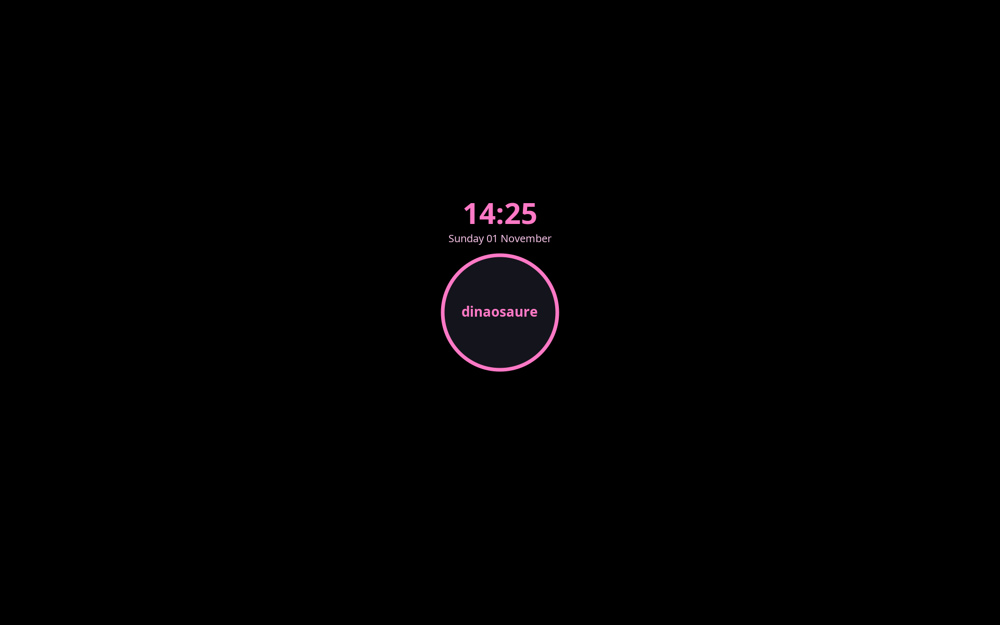

# i3lock – Lock Screen

A custom lock screen for **i3wm on Arch Linux**, built with [i3lock-color](https://github.com/Raymo111/i3lock-color).
Black background, pink ring, clock, and a custom greeter text.



## Features

- Solid black background (instant lock, no blur delay)
- Clock and date above the ring
- Custom greeter text inside the ring
- Dark pink highlight on keypress, dark purple on backspace
- Red ring + `wrong password` message on failed attempts
- Launchable from **dmenu** with a simple `lock` command
- The classic `i3lock` command still works alongside it

## Prerequisites

Install `i3lock-color` from the AUR:

```bash
yay -S i3lock-color
```

> `i3lock-color` conflicts with `i3lock` and will replace it. Answer **yes** when asked.
> The `i3lock` command stays available, so nothing else breaks.
> To go back: `sudo pacman -S i3lock`

## Installation

1. Copy the script and make it executable:

```bash
mkdir -p ~/.local/bin
cp i3lock/lock ~/.local/bin/lock
chmod +x ~/.local/bin/lock
```

2. Make it visible to dmenu (i3 does not always load `~/.local/bin` into its `PATH`):

```bash
sudo ln -s ~/.local/bin/lock /usr/local/bin/lock
rm -f ~/.cache/dmenu_run
```

3. Test it:

```bash
lock
```

## i3 config

Add these lines to `~/.config/i3/config`, then reload i3 (`$mod+Shift+r`):

```
# Lock screen with Ctrl+Alt+L
bindsym Ctrl+Mod1+l exec --no-startup-id ~/.local/bin/lock

# Use the custom lock screen on suspend (replaces the default xss-lock line)
exec --no-startup-id xss-lock --transfer-sleep-lock -- ~/.local/bin/lock --nofork
```

> `$mod+l` is not used because it is bound to `focus up` in the default i3 config.
> The script forwards extra arguments (`"$@"`), so `--nofork` reaches i3lock.

## Usage

| Action | How |
|---|---|
| Lock with the custom theme | `Ctrl+Alt+L` or `$mod+d` → `lock` |
| Lock with the classic i3lock | `$mod+d` → `i3lock` |
| Lock on suspend | automatic (xss-lock) |

## Taking a screenshot of the lock screen

i3lock grabs the keyboard, so screenshot shortcuts don't work while locked. Use a delay instead:

```bash
lock & sleep 2 && scrot ~/preview.png
```

## Customization

Edit `~/.local/bin/lock`. Colors use the `RRGGBBAA` format (last two digits = opacity).

| Option | Value | Role |
|---|---|---|
| `--color` | `000000` | Background |
| `--ring-color` | `ff79c6ff` | Ring (idle) |
| `--inside-color` | `1a1a24cc` | Inside of the ring |
| `--keyhl-color` | `c2185bff` | Keypress highlight |
| `--bshl-color` | `6a1b9aff` | Backspace highlight |
| `--ringver-color` | `f5c2e7ff` | Ring while verifying |
| `--ringwrong-color` | `ff5555ff` | Ring on wrong password |
| `--greeter-text` | `dinaosaure` | Text inside the ring |

Want a blurred screenshot instead of black? Replace `--color=000000` with `--blur 8` (slower to lock).

Full list of options: `man i3lock`

## Notes

- The `no input` message (shown when pressing backspace on an empty field) is not positioned by `--wrong-pos` but by `--status-pos`, which is not clearly documented in `man i3lock`. It is set here so the message appears below the ring instead of over the greeter text.
